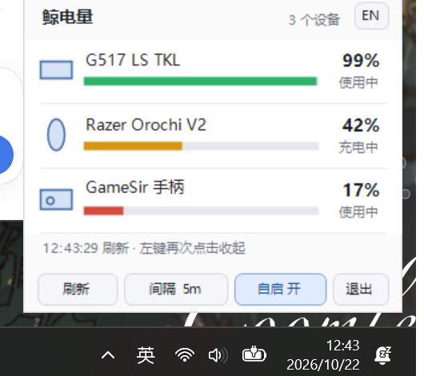

# 鲸电量 BattWhale


常驻 Windows 系统托盘的 2.4G 无线外设电量监视器。只读 HID，不装驱动、不常驻服务、不联网。



- 单个 `BattWhale.exe`，约 **75 KB**，依赖系统自带的 .NET Framework 4.8（Win10/11 自带）
- 实测占用：私有内存约 **24 MB**、工作集约 40 MB（WinForms 的固有开销），CPU 空闲时为 0
- 界面是浅色面板，操作按钮（刷新 / 间隔 / 自启 / 退出）都在面板底部，右键不再弹独立菜单；托盘图标会自动跟随任务栏深浅换描边
- 托盘图标按最低电量变色（绿 ≥50%、黄 ≥20%、红 <20%），左键或右键都弹出同一个面板

## 下载

不想自己编译的话，直接去 [Releases](https://github.com/maomaoHatsune/BattWhale/releases) 下 `BattWhale.exe`。
它是未签名的，第一次运行会被 SmartScreen 拦一下（「更多信息 → 仍要运行」），或者用仓库里的
`build.ps1` 自己编一个、顺手生成 `启动.vbs` 绕开它。

## 快速开始

```bat
build.cmd                 :: 或 powershell -ExecutionPolicy Bypass -File build.ps1
bin\BattWhale.exe         :: 直接跑（exe 没签名，explorer 里首次会弹 SmartScreen）
bin\BattWhale.exe --once  :: 打印一次电量后退出
bin\BattWhale.exe --diag  :: 诊断：HID 接口 + 各协议原始回复
```

`build.ps1` 编译完会顺手在根目录生成一个 `启动.vbs`（绝对路径写死）——exe 没有代码签名，
explorer 直接双击会被「Windows 已保护你的电脑」拦一次；这个启动器用 `WScript.Shell.Run`
走 `CreateProcess`，不经过 shell 的那道检查，所以不会弹。把它拖到桌面/开始菜单当快捷方式即可。

> 想彻底不弹只有两条路：买代码签名证书，或关掉
> 「应用和浏览器控制 → 基于声誉的保护 → 检查应用和文件」（需要管理员）。
> 注：`启动.vbs` 带本机绝对路径，所以没有进仓库，每次编译自动生成。

开机自启在面板底部的「自启」按钮里开关（写 `HKCU\...\Run`，不需要管理员）。

再双击一次程序会把已经在运行的面板弹出来，不会再弹「已经在运行」的对话框。

### 图标找不到时

**最重要的一条：从文件资源管理器里双击 `bin\BattWhale.exe`。**
从 IDE、聊天窗口、沙箱终端里启动会被降成「低完整性」进程，Windows 的 UIPI 会直接拒绝
`Shell_NotifyIcon`（`win32=5`），表现就是「进程在跑、面板能弹、任务栏没图标」。

程序启动时若检测到低完整性，会尝试经 `explorer.exe` 重新拉起自己（正常桌面下会成功）；
万一转正失败，会弹一次提示并降级成「只有面板、没有图标」。

启动后 `bin\battwhale.log` 里会留一行 `托盘图标已注册` 或失败原因，排查先看它。

Win11 默认把新图标塞进任务栏的 `^` 溢出区，点开 `^` 就能看到，右键可以「固定到任务栏」。

```
bin\BattWhale.exe --once     能打印电量 = 后台在读，只是图标没出来
bin\BattWhale.exe --traytest 托盘自检：弹窗显示 session / integrity / NIM_ADD / 图标坐标
```

`BATTWHALE_DEBUG=1` 启动时会往 exe 同目录写 `debug.log`，记下每次刷新的结果。

## 当前实测情况（本机）

| 设备 | 状态 | 说明 |
|---|---|---|
| 罗技 G517 LIGHTSPEED TKL（接收器 046D:C547 / 有线 046D:C35A） | ✅ 正常 | HID++ 2.0，`0x1004 UNIFIED_BATTERY` |
| 雷蛇八岐大蛇 V2（1532:0094） | ✅ 正常 | 走雷云自己的 `RZCONTROL` 控制设备转发 feature report，**不需要管理员**，也不用卸载雷云 |
| 盖世小鸡超新星（3537:103E） | ⚠ 读不到 | 走 XInput，`XInputGetBatteryInformation` 不返回电量；厂商通道 0xFFA0（64 字节入 / 32 字节出）协议未知 |

> 雷蛇的 90 字节控制口在用户态被 `RzDev_0094.sys` 虚拟化（直接开 HID 只会拿到
> `status=0x00 / tid=0x05` 的死包）。而驱动同时建了一个 `RZCONTROL` 控制设备，
> 它的 `0x88883010` / `0x88883014` 两个 IOCTL 分别转发 `IOCTL_HID_SET_FEATURE` /
> `IOCTL_HID_GET_FEATURE`——从那里发同样的 90 字节报文就能拿到真数据。
> 注意报文要带 1 字节 HID report id 前缀，字段整体后移一位。

> 罗技键盘休眠时接收器不应答，程序会保留上次读数并标记「休眠中」，按下按键即恢复刷新。

### 一个容易踩的坑：同一台设备会应答多个索引

有线设备的 HID++ 集合会对 `0xFF` **和** `1..6` 全部应答，按「每个索引一台设备」去扫，
列表里就会出现同一把键盘的 3~4 条重复。现在的做法是：先探 `0xFF`，应答就认定它是
「直连设备」，只读 `0xFF`；接收器不会应答 `0xFF`，才去扫 `1..4`。另外再加一层同名去重，
防止有线 + 接收器同时在线时又冒出一条。

设置与上次读数会依次尝试 `%APPDATA%`、`%LOCALAPPDATA%`、exe 目录、`%TEMP%`，
用第一个真的能写的；实际用了哪个会写进 `battwhale.log` 的「数据目录」那行。

## 想支持别的外设？拿自己的设备再跑一遍

这个项目不是「通用驱动」。上面三种读法都是拿**具体设备**的实机报文一条条对出来的：
罗技的 feature 索引、雷蛇 90 字节报文里 `arg1` 的位置、XInput 的档位映射，全是逆出来的，
不是照文档抄的。所以换一把新键盘 / 新鼠标，**大概率不能开箱即用**，得用你自己的设备重跑一遍。

流程（这正是 AI agent 最擅长的活）：

1. `bin\BattWhale.exe --hidscan` —— 列出所有 HID 接口：VID/PID、usage page、设备路径；
2. `bin\BattWhale.exe --hidread <路径>` —— 把该接口的 feature report 原始字节打出来，
   协议不明的设备就靠这一步把「报文长什么样」记下来；
3. `bin\BattWhale.exe --diag` —— 看现有三种协议在你设备上的应答。回 `0x05` / `0x07`
   之类错误码就说明这条路不通，得换方向（雷蛇当年就是全 `0x05`，最后顺着它的驱动才通）；
4. 把 1–3 的原始输出、设备型号、驱动版本一起丢给 agent，让它在 `src/providers/` 里
   照 `LogitechProvider` / `RazerProvider` 的结构补一个 provider；
5. `build.ps1` 编一版，`--once` 验证读数。

可以直接把这段提示词给它：

> 我有一台 <品牌型号>（`VID_xxxx:PID_xxxx`），想读它的电量。下面是 `--hidscan` / `--hidread` /
> `--diag` 的原始输出：<粘贴>。仓库里已有 HID++、RZCONTROL、XInput 三种实现，请照着结构加一个
> provider。要求：只读、绝不写设备、失败不能影响现有设备；先告诉我缺哪些信息，再动代码。

几条踩过的经验，能少绕两天：

- 键盘/鼠标顶层集合在 Win10 1803+ 打不开，用**零权限句柄** + `HidD_Get/SetFeature`；
- 有的厂商把 feature report 虚拟化在自己的驱动里（雷蛇就是），那就得顺着驱动暴露的控制设备走；
- HID++ 设备可能对多个索引都应答，记得去重（见上面那个坑）；
- 厂商私有通道（比如某些手柄的 `0xFFA0`）没有公开文档，只能靠 `--hidread` 抓包 + 试错。

## 它是怎么读的

| 协议 | 用途 | 关键点 |
|---|---|---|
| **HID++ 2.0** | 罗技接收器 / 直连设备 | 厂商集合 `usage page 0xFF00`；长报文 `0x11`（20 字节）；`feature 0x0000 fn0` 查特性、`0x0005 fn0/1` 设备名、`0x1004 fn1` 电量（`[0]`=百分比，`[2]`=充电状态）、`0x1000 fn0` 老设备兜底 |
| **Razer HID** | 雷蛇无线设备 | 91 字节 feature report（`report id 0x00` + 90 字节）；`class 0x07 id 0x80` 读电量（`arg1`/255*100），`0x84` 读充电；CRC 为 byte2..87 异或 |
| **RZCONTROL IOCTL** | 雷蛇（装了雷云驱动时） | 控制设备接口 `{e3be005d-d130-4910-88ff-09ae02f680e9}`；`0x88883010`=SET_FEATURE、`0x88883014`=GET_FEATURE、`0x88883140`=取挂起报文 |
| **XInput** | Xbox 模式手柄 | `XInputGetBatteryInformation`，`BatteryType` 2/3 时 `BatteryLevel` 0–4 → 0/25/50/75/100% |

微软从 Windows 10 1803 起限制普通权限打开「键盘/鼠标」顶层集合，所以 HID 通道统一用
`CreateFile(path, 0, ...)` 的**零权限句柄**打开，再用 `HidD_GetFeature/SetFeature` 读写特性报告——
这样连受限集合也能拿到 91 字节的雷蛇回包。

## 项目结构

```
build.ps1 / build.cmd       csc 编译（.NET Framework 4.8，无 SDK 依赖）
src/
  Program.cs                入口：托盘 / --once / --diag / --hidscan / --hidread
  TrayApp.cs                托盘图标、面板调度、低电提醒、开机自启
  FlyoutForm.cs             左键弹出面板
  IconFactory.cs            GDI+ 画电池图标
  BatteryService.cs         轮询调度、排序、合并上次读数
  AppSettings.cs            设置（%APPDATA%\BattWhale\settings.ini）
  ReadingCache.cs           上次读数缓存（重启后休眠设备仍有数字）
  Model.cs                  BatteryReading / 状态枚举
  Hid.cs / Interop.cs       SetupAPI + HID 枚举与带超时的读写
  ConsoleHost.cs            winexe 也能往启动它的控制台打印
  logitech/Hidpp.cs         HID++ 2.0 客户端
  providers/
    LogitechProvider.cs     罗技（并行探测 0xFF 与 1..4 号设备）
    RazerProvider.cs        雷蛇
    ControllerProvider.cs   XInput 手柄
```

## 诊断命令

```
BattWhale.exe --diag           HID 接口清单 + 罗技 HID++ 原始字节 + 雷蛇状态码 + XInput 原始值
BattWhale.exe --hidscan 3537   扫描该 VID 所有接口的 feature report（逆向用）
BattWhale.exe --hidread 3537 6 监听该 VID 所有输入报文 6 秒（逆向用）
```

设置 `BATTWHALE_DEBUG=1` 会在 exe 同目录写 `debug.log`（每次刷新会记录设备与电量）。

## 已知限制 / 下一步

1. **雷蛇**：`RzDev_0094.sys` 在设备栈里做虚拟化，第三方拿不到真实回包。可选路线：
   - 卸载雷云 3（或换雷云 4）后重试，标准 90 字节通道大概率可用；
   - 或逆向 `RzDev_0094` 的 IOCTL 直连（未文档化，风险高，未做）。
2. **盖世小鸡超新星**：需要先把 0xFFA0 厂商通道的请求格式摸清（发 32 字节命令、收 64 字节回包）。
   目前只能显示「有线/读不到电量」。
3. HID++ 1.0 老设备（Unifying 时代的鼠标）暂未实现寄存器 0x07 读数。
4. 蓝牙设备未处理，只做 2.4G 接收器。

## 许可证

自用代码，随便改。
